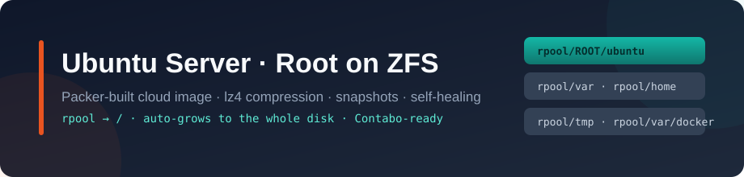

# Ubuntu Cloud Images with Root on ZFS

<p align="center"></p>

Fork of [infraguys/gci_ubuntu_zfs](https://github.com/infraguys/gci_ubuntu_zfs).
It's still a little bit complicated to have Linux with ZFS as root file system, so let's build one!

> **_NOTE:_**  This image doesn't use any of `zsys` mechanisms.

Two Packer templates live in `templates/`:

| Template | Purpose |
|---|---|
| `ubuntu-24` | Upstream generic image (kept unchanged) |
| `ubuntu-24-contabo` | The focus of this fork: Ubuntu 24.04 root-on-ZFS ready to deploy on a Contabo Cloud VPS/VDS via **Custom Images** |

## Why ZFS for the root filesystem?

A short answer for anyone landing here: ZFS turns the root filesystem into something you can
snapshot, verify and replicate as a whole, which plain ext4 cannot do.

- **Instant snapshots & rollbacks** — snapshot the entire system before an `apt upgrade` or any
  risky change (`zfs snapshot -r rpool@before`), and roll back in seconds — even from the
  initramfs if the new state does not boot.
- **End-to-end data integrity** — every block is checksummed (Merkle tree); a periodic
  `zpool scrub` detects and repairs silent bit rot — a real thing on cheap VPS storage.
- **Transparent compression** — `compression=lz4` costs almost nothing in CPU and typically
  saves 30–50% of disk space.
- **Per-dataset properties** — `/var`, `/tmp`, docker etc. are separate datasets with their own
  policies: `sync=disabled` on `/tmp`, no auto-snapshots for caches, custom `recordsize` for
  databases later.
- **Efficient backups** — `zfs send | zfs receive` gives incremental, block-level, consistent
  replication to another host.

Trade-offs to be aware of: the ARC cache eats RAM (capped here at 12 GiB), and metadata-heavy
workloads run slightly slower than on ext4. `zsys` is not used — just plain OpenZFS datasets.

## Motivation

Use upstream images as long as we can, but move data nearly as-is on ZFS pool.
So, you'll have nearly vanilla Ubuntu server image, but with ZFS :)

## Use

Contabo image (this fork): [latest release asset](https://github.com/rager306/gci_ubuntu_zfs/releases/latest/download/ubuntu-24-contabo_zfs.qcow2)
(qcow2, zstd-compressed), or see all [Github releases](https://github.com/rager306/gci_ubuntu_zfs/releases).
Generic `ubuntu-24` images built from the unmodified template are available from the
[upstream releases](https://github.com/infraguys/gci_ubuntu_zfs/releases).

## Customize

If you don't want to build image locally - just fork and push changes,
Github Actions will build image and add it as a build artifact.

## Build parameters (Contabo template)

All Contabo-specific values live in a Packer var-file `contabo.auto.pkrvars.hcl` (auto-loaded by
Packer, **git-ignored**). Copy the committed
[`contabo.auto.pkrvars.hcl.example`](templates/ubuntu-24-contabo/contabo.auto.pkrvars.hcl.example)
to `contabo.auto.pkrvars.hcl` and fill in the real values from the Contabo panel
(*Server details → IP data*). In CI the same values are rendered from **repository secrets**
(Settings → Secrets and variables → Actions):

| Secret | Example |
|---|---|
| `CONTABO_IPV4` | `203.0.113.10/24` |
| `CONTABO_IPV4_GATEWAY` | `203.0.113.1` |
| `CONTABO_IPV6` | `2001:db8:42::1/64` (or empty for IPv4-only) |
| `CONTABO_IPV6_GATEWAY` | `fe80::1` |
| `CONTABO_DNS` | `["8.8.8.8", "1.1.1.1"]` (HCL list literal) |
| `CONTABO_HOSTNAME` | `vmi1234567` |
| `CONTABO_SSH_KEY` | `ssh-ed25519 AAAA... you@example.com` |
| `CONTABO_ARC_MAX_BYTES` | `12884901888` |

| Variable | Example | Description |
|---|---|---|
| `contabo_ipv4` | `203.0.113.10/24` | Main IPv4 with prefix length |
| `contabo_ipv4_gateway` | `203.0.113.1` | IPv4 default gateway |
| `contabo_ipv6` | `2001:db8:42::1/64` | Main IPv6; set `""` for an IPv4-only config |
| `contabo_ipv6_gateway` | `fe80::1` | IPv6 gateway (link-local, hence `scope: link`) |
| `contabo_dns` | `[8.8.8.8, 1.1.1.1]` | Resolvers |
| `contabo_hostname` | `vmi1234567` | Hostname baked into the image |
| `contabo_ssh_key` | ed25519 key | Public key allowed to log in as root |
| `contabo_arc_max_bytes` | `12884901888` (12 GiB) | ZFS ARC limit |

Examples use RFC 5737/3849 documentation ranges — real values never belong in the repository.

Override by editing the pkrvars file, adding your own `*.auto.pkrvars.hcl`, setting
`PKR_VAR_contabo_ipv4=...`-style environment variables, or passing `-var` / `-var-file` to `packer build`.

Rendering chain: pkrvars → `files/contabo.conf.tpl` (templatefile) → `/tmp/contabo.conf` in the
chroot → sourced by `chroot-bootstrap.sh` with `:?` checks, so an empty value fails the build
instead of failing in production.

## What the Contabo template bakes in

| Area | Upstream `ubuntu-24` | `ubuntu-24-contabo` |
|---|---|---|
| Network | generic cloud-init/DHCP | baked static netplan (IPv4+IPv6, v6 GW `fe80::1`) |
| cloud-init | vanilla | network config disabled; **NoCloud kept** — panel/API user-data works |
| Access | ubuntu/ubuntu | root key-only; SSH password auth disabled |
| Pool size | 3.5G, manual grow | `rpool` auto-grows to the whole disk on first boot |
| ZFS ARC | default (½ RAM) | limit set via variable, lands in initramfs |

### Image internals

- Source is the official [ubuntu-24.04-server-cloudimg-amd64.img](https://cloud-images.ubuntu.com/releases/24.04/release/)
  (checksum verified by Packer); the system is moved onto ZFS with `rsync` — nearly vanilla Ubuntu.
- GPT disk, same as the cloud image: `p1` — ZFS root, `p14` — BIOS boot, `p15` — ESP, `p16` — `/boot`.
  Bootloader is GRUB in the MBR + BIOS boot partition, i.e. **legacy (SeaBIOS)** boot.
  `dd`-copied boot partitions keep their UUIDs, so the `/boot` and `/boot/efi` fstab entries stay valid.
- Kernel cmdline: `root=ZFS=rpool/ROOT/ubuntu init_on_alloc=0 init_on_free=0`;
  `zfs-initramfs` in the initramfs imports the pool by name (`zpool.cache` is not used — the image
  is portable across device names).
- First boot: `zpool-expand.service` detects the actual disk from `zpool status -LP` (works for
  `sdX`/`vdX`/`nvme`/`mmcblk`; Contabo exposes virtio_scsi = `/dev/sda*`), runs `growpart` +
  `zpool online -e` so the pool fills the whole VPS disk, then marks itself done and disables.

### Networking

- `/etc/netplan/01-contabo.yaml`: the NIC is matched by `e*` and renamed to `nic0` (independent of
  the interface name), static IPv4+IPv6, IPv6 gateway `fe80::1` with `scope: link`.
  The config is validated by `netplan generate` at build time.
- cloud-init is forbidden from touching the network (`network: {config: disabled}`) — otherwise it
  would clobber the baked config with a DHCP fallback, and Contabo offers no DHCP for custom images.
- The IPv6 part is omitted when `contabo_ipv6` is empty.

### cloud-init user-data

`datasource_list: [ NoCloud, None ]` is kept: the official Contabo way to configure an instance is
cloud-init user-data — the textarea in the panel on **Reinstall** (with the cloud-init toggle green),
or the `user_data` field in the API / Terraform provider. It is applied on the first boot
(packages, users, runcmd...). Without a config drive cloud-init falls back to `None` and runs
nothing. Build-time data does not leak: `cloud-init clean --seed` removes the build seed directory.

### Security

- root login is key-only (`PermitRootLogin prohibit-password`); password and keyboard-interactive
  SSH auth are disabled globally via the `00-contabo.conf` drop-in. sshd uses the **first** value
  obtained per keyword, so the drop-in must sort before cloud-init's `50-cloud-init.conf`
  (which is removed as well).
- `/etc/machine-id` is reset at build time — every deployment gets its own.
- The `ubuntu` user with password `ubuntu` is kept for the Contabo VNC console only
  (emergency access; SSH passwords are off). Lock it with `passwd -l ubuntu` if unwanted.

### Known specifics

- SSH host keys are baked at build time and shared by every deployment of the same image.
  Regenerate after first boot:
  `rm /etc/ssh/ssh_host_* && dpkg-reconfigure openssh-server && systemctl restart ssh`.
- Legacy/SeaBIOS boot only (no UEFI bootloader installed).
- `recordsize` is default everywhere; `/tmp` and docker datasets are excluded from auto-snapshots.

## Build

You can easily build it by yourself, prerequisites:
- Linux with KVM, root
- Packer
- Qemu (`qemu-system-amd64 qemu-utils cloud-image-utils`)
- `sudo ./build.sh [TEMPLATE_NAME]` (e.g. `sudo ./build.sh ubuntu-24-contabo`)
- Result: `templates/<name>/output/<name>_zfs.qcow2` (zstd-compressed)

**CI:** a push builds the matrix via Github Actions and uploads the artifact
`ubuntu-24-contabo-qcow2` (kept ~90 days). Pushing a **tag** (e.g. `v1`) publishes a Release with
the asset `ubuntu-24-contabo_zfs.qcow2` — its URL can be handed to Contabo Custom Images directly.

## Deploying to Contabo

Contabo custom image requirements: qcow2 (internal compression is fine — this build is zstd;
archive-style compression like `.gz` is not), x86-64, virtio (`virtio_scsi` for the disk,
`virtio_net` for networking) — all present in the Ubuntu cloud kernel.

Checklist:

1. Push a tag → Release → copy the asset URL (or use the Actions artifact).
2. Panel → **Custom Images → Add custom image** → paste the URL.
3. Make the **cloud-init toggle green** on the VPS → **Reinstall** → select the image,
   boot type **legacy** (SeaBIOS).
4. (Optional) paste cloud-init user-data — it will run on the first boot.
5. Log in: `ssh -i <key> root@<server-ip>`.

Post-install verification:

```bash
zpool list rpool                                  # SIZE ≈ the whole VPS disk
zfs list -o name,mountpoint,used                  # layout as documented below
systemctl status zpool-expand.service             # inactive/disabled after success
cat /sys/module/zfs/parameters/zfs_arc_max        # 12884901888
ip -br a show nic0                                 # both addresses
```

## Dataset layout example

(Mix of [Ubuntu](https://openzfs.github.io/openzfs-docs/Getting%20Started/Ubuntu/Ubuntu%2022.04%20Root%20on%20ZFS.html) and [Debian](https://openzfs.github.io/openzfs-docs/Getting%20Started/Debian/Debian%20Bookworm%20Root%20on%20ZFS.html) official guides)

```
# zfs list
NAME                   USED  AVAIL  REFER  MOUNTPOINT
rpool                 1.06G  7.41G    24K  /
rpool/ROOT             931M  7.41G    24K  none
rpool/ROOT/ubuntu      931M  7.41G   931M  /
rpool/home            63.5K  7.41G    33K  /home
rpool/home/root       30.5K  7.41G  30.5K  /root
rpool/srv               24K  7.41G    24K  /srv
rpool/tmp               96K  7.41G    96K  /tmp
rpool/var              157M  7.41G   660K  /var
rpool/var/cache       72.4M  7.41G  72.4M  /var/cache
rpool/var/lib         82.7M  7.41G  82.7M  /var/lib
rpool/var/lib/docker    24K  7.41G    24K  /var/lib/docker
rpool/var/lib/nfs       24K  7.41G    24K  /var/lib/nfs
rpool/var/log          994K  7.41G   994K  /var/log
rpool/var/mail          24K  7.41G    24K  /var/mail
rpool/var/snap          24K  7.41G    24K  /var/snap
rpool/var/spool         25K  7.41G    25K  /var/spool
rpool/var/tmp           36K  7.41G    36K  /var/tmp
```

## Dataset properties

- `recordsize` is default on every dataset, may be optimized in future (for ex. for some databases)
- whole pool has:
  - `compression=lz4`
  - `xattr=sa`
  - `dnodesize=auto`
  - `acltype=posixacl`
  - `atime=off`
  - `autotrim=on`
- Some non-mission-critical datasets have `com.sun:auto-snapshot=false`
- `rpool/tmp` has `sync=disabled` ([programs must not assume that any files or directories in /tmp are preserved between invocations of the program](https://refspecs.linuxfoundation.org/FHS_3.0/fhs/ch03s18.html))

(See `prepare-zfs-root.sh` for exact create commands)
